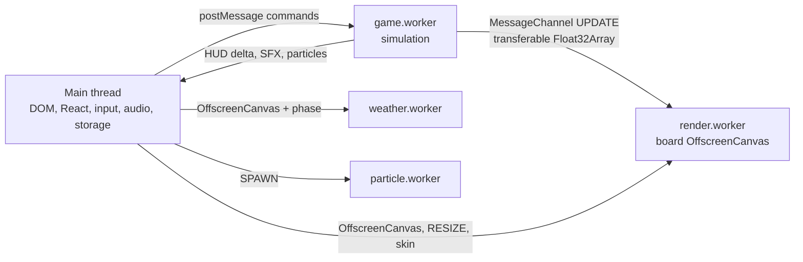

# Runtime architecture

How the Snake client splits the browser main thread from gameplay. Stack decisions that must not change without an ADR live in [`AGENTS.md`](../AGENTS.md). This document describes the runtime that is already implemented.

## Five event loops

The page runs five JavaScript event loops. Each worker has its own heap. Game state is not shared memory: there is no `SharedArrayBuffer` and no `Atomics` on the simulation path. Threads meet only in the browser message queues.

| Loop | Owner | Runs |
|---|---|---|
| Main (window) | React 18 | DOM, input, HUD, audio, `localStorage`, i18n, theme |
| `game.worker` | `src/workers/game.worker.ts` | Movement, collision, bosses, power-ups |
| `render.worker` | `src/workers/render.worker.ts` | Board paint on an `OffscreenCanvas` 2D context |
| `weather.worker` | `src/workers/weather.worker.ts` | Phase weather on its own canvas |
| `particle.worker` | `src/workers/particle.worker.ts` | Bursts and explosions on its own canvas |

`requestAnimationFrame` inside a worker is aligned to the display refresh, and the callback runs on that worker, not on the main thread.



## Main thread

The main thread keeps only what the browser delivers there.

- **Input.** `useKeyboard` listens on `window` in the capture phase. Direction, speed boost, and poison become `postMessage` commands (`SET_DIRECTION`, `SET_SPEED_BOOST`, `FIRE_POISON`, `SET_FIRING_POISON`). The handler does not move the snake. Touch controls post the same commands.
- **Layout.** `ResizeObserver`, `resize`, and `orientationchange` measure the board and send `RESIZE` with CSS width, CSS height, and `devicePixelRatio`.
- **HUD.** `useGameLoop` writes worker deltas into `src/state/gameStateStore.ts`. Components read a slice with `useSyncExternalStore` (`useGameStateSlice`). A tick that only moves the snake does not reconcile the whole tree. Leaves that read the store are wrapped in `React.memo` ([ADR-0004](./ADR/0004-react-external-store-and-css-driven-background.md)).
- **Audio.** Howler stays here (`src/utils/sfxEngine.ts`). The game worker posts `{ type: 'SFX', id }`; the main thread calls `sfxEngine.play`.
- **Storage and chrome.** `localStorage` (high score, achievements, theme, skin, mute, volume), i18next, and the theme boot script. The high score is sent into the worker on `INIT` / `START_GAME`. Achievements come back as `SAVE_ACHIEVEMENTS`.
- **Canvases.** The board, weather, and particle `<canvas>` elements are created in React, then transferred once with `transferControlToOffscreen()`. After the transfer, the main thread cannot call `getContext` on that canvas.

Skin and locale cannot be read from the DOM inside the render worker. The main thread posts `UI_SKIN` (a serializable palette) and `UI_LOCALE` (the active boss name). A short eat flash is `UI_HINT`, not a full state push.

## Two clocks

### Simulation (`game.worker`)

`START_GAME` starts `requestAnimationFrame(loop)` on the worker. The callback wakes about once per display frame. The snake moves only when the phase interval has elapsed:

```ts
if (timeSinceLastUpdate >= effectiveSpeed) {
  updateGame(...)
  broadcastState()
}
```

`effectiveSpeed` starts at `GAME_CONFIG.gameSpeed` (120 ms) and the difficulty curve can bring it down to `DIFFICULTY_CONFIG.minSpeed` (40 ms). An active speed boost divides that interval by 4. Pause calls `cancelAnimationFrame`.

Input is a queue, not an instant turn. `SET_DIRECTION` pushes onto `directionQueue` while the queue length is under 3 and the direction differs from the last queued one. Each simulation tick consumes one entry with `shift()`. Reverse-controls are applied in the worker when the direction is resolved, not in the DOM handler.

### Paint (`render.worker`)

The render worker has its own `requestAnimationFrame`. Between simulation ticks it interpolates:

```ts
t = clamp((now - lastUpdate) / speed, 0, 1)
```

Head and body are drawn at `t`, so the board paints at display rate while the simulation steps at roughly 8–25 Hz. `speed` sent to the renderer is `max(effectiveSpeed, 16)`.

A frame skips the draw when three things are true: the visual state is not dirty, interpolation has finished (`t >= 1`), and the snake is not blinking invulnerability. Collision stays on the logical 40×40 grid inside `game.worker`. The renderer sets `cellSize = cssWidth / gridSize` and the backing store to `cssSize × devicePixelRatio`.

Weather and particles use the same pattern: their own `requestAnimationFrame`, `clearRect`, and Canvas 2D, each on the canvas that was transferred to them.

## Message channels

### Main thread ↔ `game.worker`

`new Worker(..., { type: 'module' })` plus `postMessage`. Payloads are structured-cloned.

Commands in: `INIT`, `START_GAME`, `PAUSE_GAME`, `RESET_GAME`, `SET_DIRECTION`, `SET_SPEED_BOOST`, `FIRE_POISON`, `SET_FIRING_POISON`, `SET_STATUS`, `RESUME_AFTER_DEATH`, phase and boss debug messages, `CONNECT_RENDER_WORKER`.

State out: `GAME_STATE_DELTA`. The first broadcast is the full state (`isFullUpdate`). Later broadcasts are the diff from `computeDelta`. The snake polyline is not pushed through React on every step.

Also out: `SFX`, `SPAWN_PARTICLES`, `GAME_OVER_OR_DYING`, `SAVE_ACHIEVEMENTS`, and perf batches. Boss ability `effect` functions are stripped before clone (`src/utils/bossPublish.ts`); structured clone cannot carry functions.

### `game.worker` ↔ `render.worker`

`GameBoard` creates one `MessageChannel` and transfers `port1` to the render worker and `port2` to the game worker. Visual state does not round-trip through React.

On a visual change, or when `isRenderDirty` is set, the game worker posts `UPDATE` on that port. Snake and boss positions are packed into `Float32Array` (`x, y` pairs) and listed in the transfer list, so those `ArrayBuffer`s move without a copy. Shots, food, obstacles, portals, the guardian flag, speed, status, and `invulnerableUntil` are cloned; those lists stay small.

### Main thread → `render.worker`

`INIT` transfers the board `OffscreenCanvas` together with the initial CSS size, `devicePixelRatio`, and the mobile flag. Later messages are `RESIZE`, `UI_SKIN`, `UI_HINT`, `UI_LOCALE`, and `CONNECT_GAME_WORKER`.

### Particles

The game worker does not hold a port to `particle.worker`. It posts `SPAWN_PARTICLES` to the main thread. `spawnParticles` dispatches `game-spawn-particles` on `window`. `ParticleSystem` converts the grid cell to pixels with `getBoundingClientRect()` and posts `SPAWN` to the particle worker. That hop exists so the burst uses the current CSS size of the board.

### Weather

The weather worker does not follow the simulation tick. React sends the current phase id and the canvas size; the worker animates on its own frame loop.

## What must stay where

| Concern | Thread |
|---|---|
| DOM, React reconciliation, CSS | Main |
| Keyboard, pointer, resize | Main |
| Howler / `AudioContext` | Main |
| `localStorage` | Main |
| Simulation tick and collision | `game.worker` |
| Board pixels | `render.worker` |
| Weather pixels | `weather.worker` |
| Particle pixels | `particle.worker` |

Moving the simulation or the board paint back onto the main thread requires a new ADR. Decorative motion that does not depend on game state stays in CSS `@keyframes` on the compositor, not in a `setInterval` that calls `setState` ([ADR-0004](./ADR/0004-react-external-store-and-css-driven-background.md)). The board renderer stays Canvas 2D until a measured frame budget says otherwise ([ADR-0002](./ADR/0002-keep-canvas2d-defer-pixijs.md)).
