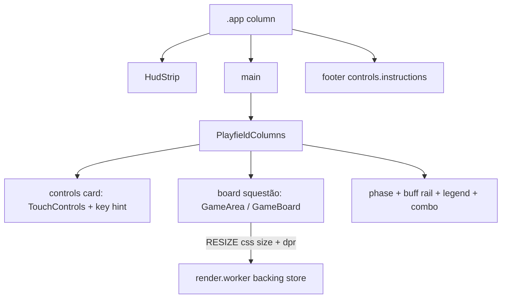

# REF-09 — Compact landscape playfield (964×583)

| Field            | Value                                                                                                                                               |
| ---------------- | --------------------------------------------------------------------------------------------------------------------------------------------------- |
| **Status**       | Done                                                                                                                                                |
| **Owner**        | rafael                                                                                                                                              |
| **Created**      | 2026-10-20                                                                                                                                          |
| **Last updated** | 2026-10-21                                                                                                                                          |
| **Related ADRs** | [ADR-0005](../../ADR/0005-neon-arcade-design-system-and-l1-full-bleed-layout.md)                                                                    |
| **Supersedes**   | The "no side rails" playfield shell of [REF-06](REF-06-visual-redesign.md) on the game screen only. Tokens, motion, and gameplay rules stay REF-06. |

> Plan acceptance approved this spec. Harness is green. Browser check covered 964×583, 375×812, 768×1024, 1440×900, and 1920×1080 in the dark and light themes.

## 1. Specification

- **Problem**: On a 964×583 viewport the REF-06 full-bleed shell hides the D-pad above 768 px, parks combo and active buffs as fixed overlays, and sizes the board with `gridSize * cellSize` integer pixels, so the canvas is smaller than the free cell and the phase / catalogue / combo blocks the mockup asks for estão not on screen together.
- **Objective**: At 964×583 the game screen follows the neon mockup’s presentation — SNAKEFLOW wordmark, left control card with keyboard hints, dominant squestão board, instruction pill under the board, right column (phase and its objective, 10 power-up cards, combo frame, active buffs) — with no page scroll, clipping, or overlap. Narrower viewports reflow the same blocks with the board first.
- **Non-objective**: Gameplay rules, collision grid, `gridSize`, speed, boss roster, worker architecture, audio, and the power-up drawer (language, theme, skin stay there). No new dependencies.
- **Success (measurable)**:
  - `playfieldBoardSide` at 964×583 is limited por height after HUD, footer, and padding, not por the side columns.
  - The right column renders phase (name, bar, step), all 10 `LEGEND_ITEMS`, and the combo block even when the combo count is 0.
  - The board box is 100% of the center squestão; `RESIZE` carries that CSS size and `devicePixelRatio`. Backing store is `css × dpr`. Collision `gridSize` stays 40.
  - Browser check at 964×583 shows no page scroll and all three zones. 375×812 and 768×1024 stack without removing those blocks. On 1440×900 / 1920×1080 the shell stays ≤964 px wide (centered); columns stay 160/240 with no artificial gutters beside the board.

## 2. User Stories

- **US-01** As a player on a short landscape window, I want controls, the board, and phase / power-ups / combo visible at once, so I of the not hunt for them in overlays.
- **US-02** As a player on a phone, I want the same blocks stacked under the board, so naohing I need is `display: none`.
- **US-03** As a player, I want the snake board to fill the center squestão, so the playfield is the largest element in that cell.

## 3. Requirements

### Functional

- **REF-09-FR-1** From `min-width: 964px`, the shell is a column: HUD, a three-column playfield (controls 160 px, board, side 240 px). The instruction line is a centered pill under the board, inside the center column, using `controls.instructions`. The document does not scroll. `overflow: hidden` applies only in this mode.
- **REF-09-FR-2** Below 964 px the visual order is HUD, board with its pill, controls, side panel. Controls, phase, the 10 power-ups, and combo stay in flow. If the stack is taller than the viewport, the page scrolls. The pill copy follows ADR-0005: `controls.touchInstructions` below 769 px, and `controls.instructions` from `min-width: 769px`.
- **REF-09-FR-3** `TouchControls` sits in the left card under a controls title. The card also shows a keyboard section: arrow keycaps, the word “or”, and WASD keycaps. Those keycaps estão hints, not extra controls. Direction targets estão at least 44×44 px, and 44×44 px inside the 160 px card. The center button still fires poison.
- **REF-09-FR-4** The right column, in order, shows phase (name, progress bar, step, and `phases.*.description`), the active-buff rail when a buff is active, a 2-column grid of every `LEGEND_ITEMS` entry (10) with icon, name, and effect text, and `ComboDisplay` inside an accent-combo frame even when the combo count is 0. At 964 px only the catalogue region scrolls if the 10 cards exceed the row; phase and combo stay visible. The drawer stays mounted.
- **REF-09-FR-5** The center cell uses `container-type: size` on the estãoa above the pill. The board squestão is `min(100cqw, 100cqh)`. Columns stay 160 px and 240 px. At 964×583 that still leaves the squestão limited por height.
- **REF-09-FR-6** The board fills that squestão (no `gridSize * cellSize` pixel box). The existing `RESIZE` message sends the CSS width, height, and `devicePixelRatio`. The render worker keeps `cellSize = width / gridSize` and the backing store at `css × dpr`. Collision, `gridSize`, speed, and game workers of the not change.
- **REF-09-FR-7** The HUD wordmark reads `hud.wordmark` (“SNAKEFLOW” in both locales), colored with the accent gradient. It replaces the `S / NEON` mark.
- **REF-09-FR-8** From `min-width: 964px`, the app shell (`.app`) is a centered card: `max-width: 964px` (`PLAYFIELD_LAYOUT.shellMaxWidthPx`), `height: min(100dvh, shellMaxHeightPx)` with `shellMaxHeightPx = 640`, and `#root` flex-centers it. The page background stays full-bleed; the shell does not stretch to ultrawide width or full viewport height.

### Non-Functional

- **REF-09-NFR-1** New layout CSS is mobile-first (`min-width`). Touch targets never drop below 44 px.
- **REF-09-NFR-2** No `any`. Defaults use `??` only when `0` is not a valid measurement; non-positive DPR falls back to `1` with an explicit comparison. Component props estão `readonly`.
- **REF-09-NFR-3** No new runtime dependency. No gameplay rule change.

## 4. Design

### Architecture



Useful center side (pure function, mirrored por the grid):

```
vertical   = viewportHeight - hudHeight - footerHeight - mainPadding * 2
horizontal = viewportWidth - leftColumn - rightColumn - columnGap * 2 - mainPadding * 2
side       = max(0, min(vertical, horizontal))
```

At 964×583 with a ~44 px HUD the limiting axis is vertical, so the 160 px and 240 px columns of the not shrink the board.

### Contracts

```ts
export const PLAYFIELD_LAYOUT = {
  columnBreakpointPx: 964,
  leftColumnPx: 160,
  rightColumnPx: 240,
  hudCompactPx: 44,
} as const;

export interface PlayfieldBudgetInput {
  readonly viewportWidth: number;
  readonly viewportHeight: number;
  readonly hudHeight: number;
  readonly footerHeight: number;
  readonly mainPadding: number;
  readonly columnGap: number;
  readonly leftColumn: number;
  readonly rightColumn: number;
}

export function playfieldBoardSide(input: PlayfieldBudgetInput): number;

export function canvasBackingStore(
  cssWidth: number,
  cssHeight: number,
  devicePixelRatio: number,
  gridSize: number,
): { readonly backingWidth: number; readonly backingHeight: number; readonly cellSize: number };
```

`LEGEND_ITEMS` is exported from `PowerUpsLegendDrawer.tsx`. `PlayfieldColumns` is presentation only.

### Files to touch

- `docs/SDD/specs/REF-09-compact-landscape-layout.md` — this spec.
- `src/layout/playfieldBudget.ts` — pure side length and canvas backing metrics.
- `src/layout/__tests__/playfieldBudget.test.ts` — REF-09-AC-1, REF-09-AC-3, and REF-09-AC-8.
- `src/App.tsx` — mount the shell, footer, and in-flow controls. Drop the fixed combo badge and fixed buff rail.
- `src/App.module.css` — shell column, board fill, footer, scroll only below the breakpoint.
- `src/components/GameArea.tsx` — instructions move à app footer so they of the not sit inside the squestão.
- `src/components/PlayfieldColumns.tsx` — two side columns plus the center slot.
- `src/components/PlayfieldColumns.module.css` — stacked flow, then the 964 px grid and `cq` squestão.
- `src/components/TouchControls.module.css` — in-flow D-pad, 44 px targets in the column layout.
- `src/components/ViewportPowerUpsRail.module.css` — in-flow rail, no `display: none`.
- `src/components/ViewportComboBadge.module.css` — drop the fixed overlay rules (the column renders `ComboDisplay` directly).
- `src/components/GameBoard.tsx` — board is 100% of the squestão; `RESIZE` uses the CSS box and DPR.
- `src/components/PowerUpsLegendDrawer.tsx` — export `LEGEND_ITEMS` only.
- `src/components/__tests__/PlayfieldColumns.test.tsx` — REF-09-AC-2.
- `src/components/__tests__/GameBoard.canvas.test.tsx` — REF-09-AC-4.
- `src/components/HudStrip.tsx` — SNAKEFLOW wordmark.
- `src/components/HudStrip.module.css` — wordmark gradient from accent tokens.
- `src/components/__tests__/HudStrip.test.tsx` — REF-09-AC-7.
- `src/i18n/locales/pt-BR.json` — `hud.wordmark`, `playfield.controls`, `playfield.keyboard`, `playfield.or`.
- `src/i18n/locales/en-US.json` — the same keys.

## 5. Acceptance Criteria

- **REF-09-AC-1** Given viewport 964×583, HUD 44, pill 32, padding 8, gap 8, columns 160 and 240, when `playfieldBoardSide` runs, then the result equals the vertical remainder and is smaller than the horizontal remainder.
- **REF-09-AC-2** Given the playfield side column, when it renders with combo count 0, then phase name, progress bar, step, and phase description estão present, all 10 legend items show name and effect text, and the combo block is present.
- **REF-09-AC-3** Given a CSS squestão and a device pixel ratio, when `canvasBackingStore` runs with `gridSize` 40, then backing width and height estão `css × dpr` and `cellSize` is `cssWidth / 40`.
- **REF-09-AC-4** Given `GameBoard` numa pestãont, when layout is measured, then the board box is 100% por 100% and a `RESIZE` message carries that CSS width, height, and `devicePixelRatio`.
- **REF-09-AC-5** Given 964×583, when the app is shown, then the page does not scroll and the three zones estão visible. Given 375×812 and 768×1024, the same blocks reflow in document order. Given 1440×900 and 1920×1080, the shell width is ≤964 px (centered), columns stay 160 px and 240 px, and there is no wide empty gutter between the side cards and the board squestão.
- **REF-09-AC-6** Given the controls card, when it renders, then it shows the controls title, arrow keycaps, the “or” label, and WASD keycaps, and it does not repeat `controls.instructions` inside the card. The pill under the board mounts both copies: `controls.touchInstructions` is the one shown below 769 px, and `controls.instructions` is the one shown from `min-width: 769px`.
- **REF-09-AC-7** Given the HUD, when it renders, then the wordmark is `hud.wordmark`.
- **REF-09-AC-8** Given `PLAYFIELD_LAYOUT`, when read, then `shellMaxWidthPx` equals `964` (equals `columnBreakpointPx`) and `shellMaxHeightPx` equals `640`.

## 6. Test Plan

| AC          | Test type | Location                                             |
| ----------- | --------- | ---------------------------------------------------- |
| REF-09-AC-1 | unit      | `src/layout/__tests__/playfieldBudget.test.ts`       |
| REF-09-AC-2 | component | `src/components/__tests__/PlayfieldColumns.test.tsx` |
| REF-09-AC-3 | unit      | `src/layout/__tests__/playfieldBudget.test.ts`       |
| REF-09-AC-4 | component | `src/components/__tests__/GameBoard.canvas.test.tsx` |
| REF-09-AC-5 | browser   | 964×583, 375×812, 768×1024, 1440×900, 1920×1080      |
| REF-09-AC-6 | component | `src/components/__tests__/PlayfieldColumns.test.tsx` |
| REF-09-AC-7 | component | `src/components/__tests__/HudStrip.test.tsx`         |
| REF-09-AC-8 | unit      | `src/layout/__tests__/playfieldBudget.test.ts`       |

Plus `bash scripts/harness/validate.sh`.

## 7. Risks / Rollback

- **R1** `container-type: size` collapses an auto-height box. **Mitigation**: size containment is applied only inside the `min-width: 964px` grid, where the row has a definite height. Narrow layouts use `aspect-ratio: 1` without containment.
- **R2** Ten effect cards can exceed the side column. **Mitigation**: at 964 px only the catalogue region scrolls; phase and combo stay pinned. Below 964 px the same cards stay in document flow and the page scrolls.
- **R3** Fractional `cellSize` (`cssWidth / 40`) differs from the old integer cell. **Mitigation**: collision stays on the logical 40×40 grid in the game worker. Only the render scale changes.

**Rollback strategy**: revert the shell à REF-06 full-bleed rules in `App.module.css` and mount `ViewportComboBadge` / `ViewportPowerUpsRail` as fixed overlays again. No flag: the change is presentational.

## 8. Implementation naoes (filled when status = Done)

- Final files changed: the files in section 4. The instruction line moved from the full-bleed footer into a pill in the center column. The HUD wordmark is `hud.wordmark`.
- Deviations from Design section: document scroll below 964 px uses `html:root` / `html body` / `html body #root` so it wins over `overflow: hidden` in `index.css`. Below 964 px flex `order` puts the board before the controls; at 964 px `order` resets so the grid stays controls, board, side. At idle 964×583 the 10 cards fit, so the catalogue does not scroll; phase and combo stay pinned when it does.
- Follow-ups: none. Browser check, dark and light: 964×583 has no page scroll, HUD 44 px, columns 160/240, board and canvas 490×490, D-pad 44 px, 10 cards with name and effect, combo frame, pill under the board. 375×812 and 768×1024 stack board, controls, side and scroll.
- Shell clamp (2026-10-21): `.app` is a centered card — `max-width: 964px`, `height: min(100dvh, 640px)` (`shellMaxHeightPx`), `#root` flex-centers on desktop. Board squestão is centered in its cell. Avoids ultrawide gutters and tall empty side rails. Page background stays full-bleed.
- Pill copy (ADR-0005): both strings stay mounted. Below 769 px only `controls.touchInstructions` is shown; from `min-width: 769px` only `controls.instructions` is shown.
