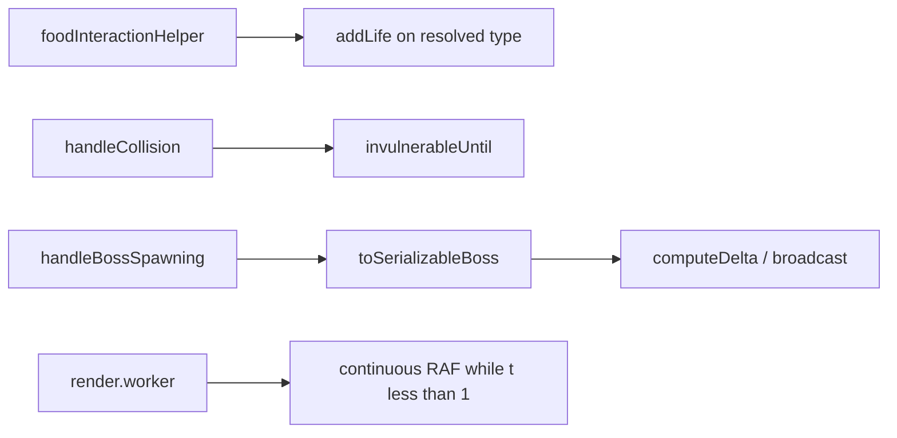

# REF-10 — Gameplay feedback and collision fixes

| Field | Value |
|---|---|
| **Status** | Done |
| **Owner** | rafael |
| **Created** | 2026-10-21 |
| **Last updated** | 2026-10-21 |
| **Related ADRs** | — |
| **Supersedes** | — |

> Status values: `Draft` → `Approved` → `In Progress` → `Done` (or `Blocked`, `Superseded`).

## 1. Specification

- **Problem**: playtesters report (1) EXTRA_LIFE feels broken vs Joker, (2) self-collision drains all lives instantly, (3) the game freezes when reaching level 10, (4) power-ups lack clear active/duration feedback, (5) the mobile target snake and pills shestão hostile red cues, (6) base movement feels stuttery until the hold-to-accelerate mechanic is discovered.
- **Objective**: fix the confirmed logic bugs and ship readable temporary/instant power-up feedback without rewriting simulation or changing working mechanics.
- **Non-objective**: new power-up types, boss redesign, WebGL, new dependencies, changing score/level formulas, removing hold-to-accelerate.
- **Success (measurable)**:
  - EXTRA_LIFE pill and Joker→EXTRA_LIFE both add one life up to `maxLives`.
  - Non-fatal damage grants 2000 ms invulnerability; a second hit inside the window does not remove anaoher life.
  - Crossing into level 10 keeps `PLAYING` and does not throw `DataCloneError` when publishing `activeBoss`.
  - Temporary effects show remaining time; instant effects show a toast without a fake duration bar.
  - Pill / boss / obstacle colors follow friendly cyan vs danger red; canvas reads `POWER_UP_CONFIG.colors`.
  - Render interpolates between ticks at the effective interval (including keyboard boost).
  - `bash scripts/harness/validate.sh` exits 0.

## 2. User Stories

- **US-01** As a player, I want EXTRA_LIFE to add a life so the pill matches its label.
- **US-02** As a player, I want 2 seconds of invulnerability after taking damage so one mistake does not wipe all lives.
- **US-03** As a player, I want the run to continue when I reach level 10 so the obstacle/boss phase is playable.
- **US-04** As a player, I want to see which temporary effect is active and when it ends so I can learn the mechanics.
- **US-05** As a player, I want the target snake and life pill to read as friendly (cyan) and hazards as red so intuition matches rules.
- **US-06** As a player, I want base movement to feel smooth so the game does not feel broken before I discover acceleration.

## 3. Requirements

### Functional

- **REF-10-FR-1** Eating `FoodType.EXTRA_LIFE` increases `lives` por 1, clamped to `LIVES_CONFIG.maxLives`.
- **REF-10-FR-2** Joker may resolve to `EXTRA_LIFE`. Life is granted from the **resolved** type, not only the raw food type.
- **REF-10-FR-3** Instant effects (`duration === 0`) never enter `activePowerUps` as timed buffs. They may emit a short activation toast (name + icon, no progress bar).
- **REF-10-FR-4** Temporary effects keep name, icon, remaining seconds, and progress bar. Board tint uses the active temporary effect color at low alpha.
- **REF-10-FR-5** After non-fatal damage, set `invulnerableUntil = now + 2000`. While `now < invulnerableUntil`, ignore self, obstacle, and boss-head damage. Fatal hit (last life) still goes to `GAME_OVER`.
- **REF-10-FR-12** Boss collision is evaluated at most once per simulation tick. After a non-fatal boss-head hit, the frame continues with the same collision result (`bossState`); `handleBossCollisionCheck` must not run again with a stale `prev` (missing the new `invulnerableUntil`).
- **REF-10-FR-6** During invulnerability the player snake blinks (alpha pulse) on the canvas.
- **REF-10-FR-7** Death overlay completion calls `resumeAfterDeath` (reposition + PLAYING), never `startGame` while status is `DYING`.
- **REF-10-FR-8** `activeBoss` published to main/render is structured-clone safe (no `effect` functions). Worker-internal logic keeps full `Chef` with abilities.
- **REF-10-FR-9** Boss spawn positions estão in-bounds, non-overlapping segments, and of the not occupy player snake cells.
- **REF-10-FR-10** Canvas food colors come from `POWER_UP_CONFIG.colors`. Poison/hazards use red family; EXTRA_LIFE and friendly target (boss visual for capture/chase targets that should read as ally) use cyan; NORMAL food is not danger-red. Small glyph overlays when color alone is ambiguous.
- **REF-10-FR-11** Render loop keeps painting while `PLAYING` until interpolation `t` reaches 1. `lastUpdate` updates only on snake/boss position change. Render payload `speed` is the effective tick interval (power-ups + keyboard boost).

### Non-Functional

- **REF-10-NFR-1** No new runtime dependencies.
- **REF-10-NFR-2** No `any`. Props `readonly`. Defaults via `??`.
- **REF-10-NFR-3** Respect `prefers-reduced-motion` for board tint / toast motion.
- **REF-10-NFR-4** Single game RAF loop; pause/reset must not stack timers.
- **REF-10-NFR-5** Simulation remains grid-step deterministic; interpolation is visual-only.

## 4. Design

### Architecture



### Contracts

```ts
// GameState addition
invulnerableUntil?: number;

// Clone-safe boss published to main/render
interface SerializableBoss {
  readonly id: string;
  readonly name: string;
  readonly phase: number;
  readonly behavior?: string;
  readonly visual: { readonly color: string; readonly icon?: string; readonly size?: number };
  readonly initialLength?: number;
  readonly abilities: readonly { readonly id: string; readonly name: string; readonly description: string; readonly cooldown?: number }[];
}

const INVULNERABILITY_MS = 2000;
```

### Files to touch

- `docs/SDD/specs/REF-10-gameplay-feedback-fixes.md` — this spec
- `src/types/game.ts` — `invulnerableUntil`; optional published-boss typing if needed
- `src/types/phases.ts` — optional serializable boss type
- `src/constants/powerUps.ts` — semantic colors
- `src/constants/lives.ts` — invulnerability duration constant (or game constants)
- `src/constants/phases.ts` — friendly cyan for target/guardian visual if required
- `src/utils/powerUps.ts` — helpers if needed for instant toast metadata
- `src/utils/lives.ts` — invulnerability helpers if extracted
- `src/utils/bossSnake.ts` — safe spawn
- `src/utils/bossPublish.ts` — **new** serializable boss mapper
- `src/workers/game/foodInteractionHelper.ts` — resolved EXTRA_LIFE + joker pool
- `src/workers/game/gameUpdateHelpers.ts` — collision + iframes
- `src/workers/game/gameUpdate.ts` — pass time into collision; wire invulnerability
- `src/workers/game/gameStateUpdates.ts` — safe obstacles on level transition if needed
- `src/workers/game/gameDelta.ts` — publish serializable boss
- `src/workers/game/gameBroadcast.ts` — effective speed + serializable boss
- `src/workers/game/gameHandlers.ts` — clear/set invulnerability on resume
- `src/workers/game/bossLogicHelper.ts` — respect iframes on boss head
- `src/workers/game.worker.ts` — effective speed for render payload
- `src/workers/render/renderDrawers.ts` — colors, glyphs, blink
- `src/workers/render/renderHelpers.ts` — invulnerability blink
- `src/workers/render/renderState.ts` — invulnerableUntil field
- `src/workers/render.worker.ts` — continuous interpolation while PLAYING
- `src/components/GameOverlays.tsx` — DeathTransition → resumeAfterDeath
- `src/components/MobileFloatingInfo.tsx` — instant effect toasts
- `src/components/PowerUpToast.tsx` — allow duration 0 toast without bar
- `src/components/GameBoard.tsx` + `.module.css` — subtle active-effect tint
- `src/components/ActivePowerUps.tsx` — ensure duration > 0 only for bar
- `src/i18n/locales/en-US.json` / `pt-BR.json` — toast / aria strings if needed
- `src/workers/game/__tests__/foodInteractionHelper.test.ts` — EXTRA_LIFE / Joker
- `src/workers/game/__tests__/collisionInvulnerability.test.ts` — **new**
- `src/workers/game/__tests__/bossCollisionOncePerTick.test.ts` — **new** (same-tick double boss check)
- `src/utils/__tests__/bossPublish.test.ts` — **new**
- `src/utils/__tests__/bossSnake.spawn.test.ts` — **new** (or extend existing)
- `src/components/__tests__/PowerUpToast.test.tsx` — **new** if missing
- `src/types/phases.ts` — `PublishedBoss` / `ActiveBoss` union for clone-safe publish

## 5. Acceptance Criteria

- **REF-10-AC-1** Given lives = 3 and food type EXTRA_LIFE, when eaten, then lives = 4 (or max if already at cap).
- **REF-10-AC-2** Given a Joker that resolves to EXTRA_LIFE, when eaten, then lives increase por 1 and no timed ActivePowerUp is added for EXTRA_LIFE.
- **REF-10-AC-3** Given a Joker that resolves to SPEED_BOOST, when eaten, then lives unchanged and a timed SPEED_BOOST ActivePowerUp is added.
- **REF-10-AC-4** Given a self-collision with lives > 1, when damage applies, then lives decrease por 1, `invulnerableUntil` is ~now+2000, and status stays PLAYING (or resumes without stacking DYING drain).
- **REF-10-AC-5** Given invulnerability active, when anaoher self/obstacle/boss-head collision occurs before expiry, then lives of the not decrease again.
- **REF-10-AC-6** Given lives = 1, when a damaging collision occurs, then status becomes GAME_OVER.
- **REF-10-AC-7** Given guardian Chef with ability `effect` functions, when mapped for publish, then `structuredClone` succeeds and no function properties remain.
- **REF-10-AC-8** Given boss spawn near a dense player snake, when initializeBossSnake runs, then no boss segment occupies a player cell and segments of the not collapse à same cell.
- **REF-10-AC-9** Given a temporary ActivePowerUp, when rendered in ActivePowerUps / toast, then remaining time / progress is shown; given duration 0 toast, then no progress bar is shown.
- **REF-10-AC-10** Harness `bash scripts/harness/validate.sh` exits 0.
- **REF-10-AC-11** Given a non-fatal boss-head collision with lives > 1 in one tick, when `handleBossCollision` runs, then lives decrease por exactly 1, `invulnerableUntil` is set, and the returned `bossState` is reused for the rest of the tick (no second `handleBossCollisionCheck` with stale prev).

## 6. Test Plan

| AC | Test type | Location |
|---|---|---|
| REF-10-AC-1..3 | unit | `src/workers/game/__tests__/foodInteractionHelper.test.ts` |
| REF-10-AC-4..6 | unit | `src/workers/game/__tests__/collisionInvulnerability.test.ts` |
| REF-10-AC-7 | unit | `src/utils/__tests__/bossPublish.test.ts` |
| REF-10-AC-8 | unit | `src/utils/__tests__/bossSnake.spawn.test.ts` |
| REF-10-AC-9 | component/unit | `src/components/__tests__/PowerUpToast.test.tsx` |
| REF-10-AC-10 | harness | `scripts/harness/validate.sh` |
| REF-10-AC-11 | unit | `src/workers/game/__tests__/bossCollisionOncePerTick.test.ts` |

## 7. Risks / Rollback

- **R1** Removing DYING for non-fatal hits changes feel of death overlay. **Mitigation**: keep overlay optional or short flash; iframes + blink estão the primary feedback; resumeAfterDeath path remains for any DYING leftover.
- **R2** Continuous render RAF increases GPU work vs dirty-only. **Mitigation**: only keep painting while PLAYING and `t < 1` or dirty; idle/paused still skip.
- **R3** Serializing boss without abilities breaks UI that relied on ability list. **Mitigation**: keep id/name/visual/ability metadata (id/name/description/cooldown) without `effect`.

**Rollback strategy**: revert REF-10 commit; no feature flag required (bugfix).

## 8. Implementation naoes (filled when status = Done)

- Final files changed: as listed in Design §4, plus hardening of `getActivePowerUps` for undefined arrays in tests.
- Deviations from Design section: non-fatal self/obstacle hits stay `PLAYING` (no DYING overlay) with `invulnerableUntil`; `DeathTransition` → `resumeAfterDeath` kept for any remaining DYING path. Boss-head non-fatal hits continue the frame via `foodResult.invulnerableUntil` instead of early-returning a DYING state.
- Follow-ups: optional short hit-flash UI when losing a life without DYING overlay; hostile bosses beyond classic/guardian can get a dedicated "enemy" palette pass.
- Review fix: `handleBossCollision` returns `{ fatalState, bossState }`; `updateGameLogic` reuses `bossState` (no second `handleBossCollisionCheck`). `GameState.activeBoss` is `ActiveBoss` (`Chef | PublishedBoss`) so publish path needs no `as unknown as Chef`.
- Validação: `bash scripts/harness/validate.sh` green (285 tests, lint, tsc, build).
